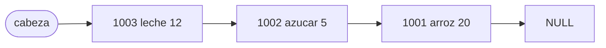

# Informe del avance

**Escenario A — Inventario de una tienda.** Integrantes: Jesús Esteban Monroy (9029007), Alejandro Serna Tovar (9030159), Juan José Guzmán (9030825).

## 1. El escenario

Este programa implementa un sistema de gestión de inventario diseñado para ser utilizado por el administrador o el personal de una tienda. Su propósito principal es mantener un registro actualizado y preciso de las existencias de mercancía, garantizando que cada producto sea único según su código. A través de este sistema, el usuario puede registrar nuevos productos, consultar el stock disponible, reponer unidades de mercancía existente y eliminar artículos que ya no se comercializan.

## 2. Qué guarda la estructura y qué operaciones necesita

Cada elemento es un `Articulo` con `codigo` (entero `long long`), `nombre` (arreglo de `char` de 64 posiciones, sin `string` de la STL) y `cantidad` (entero). La estructura guarda a lo sumo un artículo por código.

| Operación | Qué hace | Precondición |
|---|---|---|
| `AGREGAR c nombre cantidad` | Guarda un artículo nuevo; responde `repetido` si el código ya estaba. | `nombre` es una palabra no vacía de a lo sumo 63 caracteres. |
| `ELIMINAR c` | Quita el artículo con ese código; `no existe` si no está. | Ninguna. |
| `CONSULTAR c` | Escribe `c nombre cantidad`; `no existe` si no está. | Ninguna. |
| `REPONER c cantidad` | Suma `cantidad` a las existencias; `no existe` si no está. | Ninguna. |
| `LISTAR` | Escribe todos los artículos, uno por línea. | Ninguna. |

## 3. La estructura escogida y por qué

Se eligió una lista enlazada simple porque permite la inserción de nuevos elementos de forma rápida sin preocuparse por los redimensionamientos costosos de un arreglo. Como se inserta siempre al inicio, la operación agregar solo toma $O(1)$ al enlazar el nodo (aunque requiere un recorrido $O(n)$ previo para evitar repetidos). Las operaciones de búsqueda exigen un recorrido secuencial porque la lista no está ordenada por código, resultando en tiempos de $O(n)$. Al eliminar, no hay que desplazar elementos; basta desenlazar el nodo (el `anterior` pasa a apuntar al `siguiente`) en tiempo $O(1)$ tras encontrarlo.

Como los artículos nuevos se insertan al inicio, `LISTAR` los muestra del último que llegó al primero.

Referencias: A. K. Thareja, *Data Structures Using C*, 2.ª ed., Oxford University Press, cap. 6 "Linked Lists"; T. H. Cormen, C. E. Leiserson, R. L. Rivest y C. Stein, *Introduction to Algorithms*, 4.ª ed., MIT Press, sec. 10.2 "Linked lists"; Estructuras de Datos 2026-2, Clase 15 (lista enlazada).

Costos esperados, con $n$ el número de elementos:

| Operación | Tiempo | Espacio |
|---|---|---|
| `AGREGAR` | $O(n)$ | $O(1)$ |
| `ELIMINAR` | $O(n)$ | $O(1)$ |
| `CONSULTAR` | $O(n)$ | $O(1)$ |
| `REPONER` | $O(n)$ | $O(1)$ |
| `LISTAR` | $\Theta(n)$ | $O(1)$ |

La estructura completa ocupa $\Theta(n)$: un nodo por artículo.

El invariante de la estructura, como fórmula, con $L = \langle e_0, \dots, e_{n-1} \rangle$ la secuencia de artículos alcanzables desde `cabeza`:

$$I:\quad n = |L| \;\wedge\; \forall i \neq j:\ L_i.\text{codigo} \neq L_j.\text{codigo} \;\wedge\; (n = 0 \iff \text{cabeza} = \text{NULL})$$

Un diagrama del estado de la estructura después de agregar 1001, 1002 y 1003, en Mermaid:

## 4. Qué piensan medir

- **Entrada que se varía:** el número de artículos $n$, con al menos cinco tamaños: 1 000, 5 000, 10 000, 50 000 y 100 000.
- **Qué se mide:** el tiempo de un mismo número de consultas sobre el inventario ya cargado, con las tres estructuras (lista enlazada, tabla hash y `std::map`) en la misma máquina.
- **Tamaños de la tabla hash:** uno pequeño, uno cercano a $n$ y un primo mayor que $n$, más un cuarto juego de códigos escogido para que todos caigan en la misma cubeta.
- **Qué esperamos ver:** la lista crece de forma lineal, `std::map` como $\log n$ y la tabla hash casi constante, salvo en el juego de colisión, donde debe comportarse como la lista.

## 5. Casos de prueba

Los casos están en `datos/` como pares `.in` / `.out`; `make pruebas` (en `codigo/`) los corre y compara la salida con `diff`.

| Caso | Entrada | Salida esperada | Salida obtenida |
|---|---|---|---|
| funcional 1: `ejemplo1` | el ejemplo del enunciado | la del enunciado | OK |
| funcional 2: `listar2` | agrega 1001, 1002 y 1003, y `LISTAR` | tres `ok` y luego 1003, 1002, 1001 | OK |
| funcional 3: `reponer3` | agrega `1004 cafe 3`, repone 10, 7 y 1, y consulta | cuatro `ok` y `1004 cafe 21` | OK |
| límite: `vacia4` | `CONSULTAR`, `ELIMINAR`, `REPONER` y `LISTAR` sin artículos | `no existe` en cada orden; `LISTAR` no escribe nada | OK |
| límite: `repetido5` | agrega 1005 dos veces con distinto nombre, consulta y lista | `ok`, `repetido`, y se conserva el primer nombre | OK |
| límite: `unosolo6` | agrega uno, lo elimina, consulta y lo elimina otra vez | `ok`, `ok`, `no existe`, `no existe`, lista vacía, `ok` | OK |
| límite: `eliminarextremos7` | 5 artículos; elimina la cabeza (1005), el último nodo (1001) y el del medio (1003) | quedan 1004 y 1002; se puede seguir agregando | OK |

Escogimos estos casos límite porque cada uno toca un caso especial del código: la lista vacía (`cabeza` es `NULL`), un solo elemento (al eliminarlo `cabeza` vuelve a `NULL`), la clave repetida (la lista no admite dos códigos iguales) y eliminar en los extremos (quitar la cabeza y quitar el último nodo son ramas distintas de `eliminar`).
